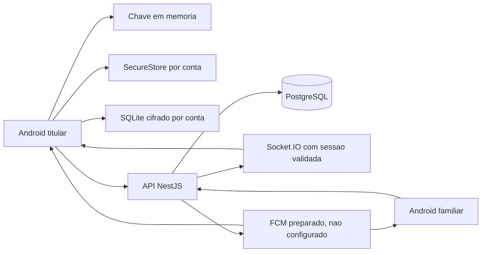
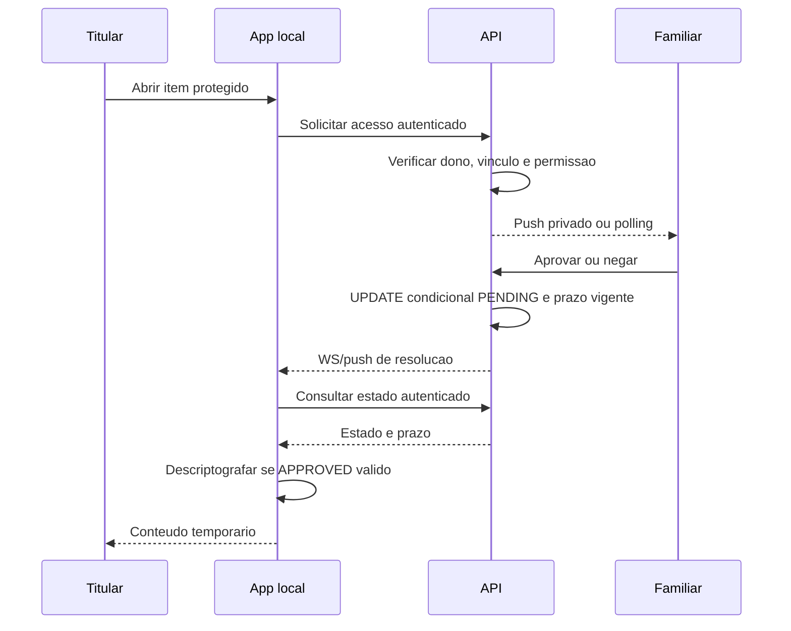
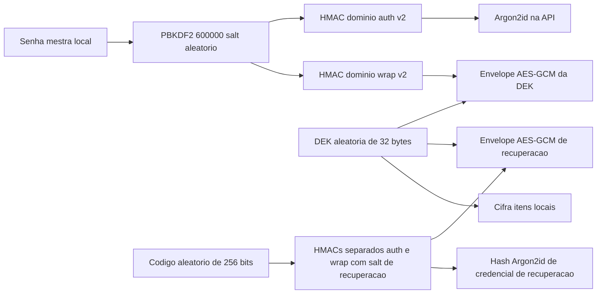

# Arquitetura e Evidencia Tecnica

Fonte para atualizar o documento academico. O DOCX original foi preservado. Diagramas descrevem codigo atual, nao certificacao de seguranca nem teste de usuarios concluido.

## Componentes

AES-256-GCM usa IV de 12 bytes e tag de 16 bytes anexada ao ciphertext em Base64. PBKDF2-HMAC-SHA256 usa 600.000 iteracoes e salt de 16 bytes. Interoperabilidade com WebCrypto foi testada. RNG vem de Expo Crypto, sem Math.random.

O patch pnpm de `@noble/hashes@1.8.0` faz o loop assincrono ceder a timers reais e reinicia seu timestamp depois de cada pausa. A revisao no Hermes mostrou que isso nao resolve o custo de SHA-256 em JavaScript: uma derivacao ficticia continuava apos 325 segundos. Ao atualizar a dependencia, reavaliar o patch e manter o teste de regressao.

O Android configura um provedor PBKDF2 assincrono nativo via `react-native-quick-crypto`/OpenSSL e Nitro Modules. O contrato conserva SHA-256, 600.000 iteracoes, salt de 16 bytes, chave de 32 bytes e UTF-8. Testes conferem referencia Node, limpeza dos buffers e rejeicao de falhas sem fallback inseguro. Expo Go rejeita a operacao explicitamente; exige development build. Node/web mantem o provedor portatil. Os testes nao substituem desempenho e fluxo completo no build Android.

Login/senha/site/notas do cofre sao cifrados no cliente. Nomes/categorias/favoritos/versoes e perfil/auditoria sao legiveis. Contas v2 enviam uma credencial HMAC derivada, nunca a senha mestra, a chave ou o codigo de recuperacao. A compatibilidade v1 envia a senha antiga uma vez durante a migracao automatica. Isso nao comprova zero-knowledge estrito contra um cliente/servidor comprometido nem elimina ataques de dicionario a senhas fracas.

## Acesso Assistido

A janela e de dez minutos a partir do pedido, nao apos aprovar. App compara prazos com o horario da API, ancorado em tempo monotonico, nao com o relogio civil do aparelho. A resposta concorrente que perde nao emite outra resolucao. Estado recupera eventos perdidos; revogacao invalida aprovacao na consulta. E controle de fluxo no cliente: familiar nao libera material criptografico, e titular ja possui a chave local.

Emergencia offline exige reautenticacao, grava evento antes de descriptografar e envia idempotentemente. Auditoria marca `offline_client_report`; servidor nao prova independentemente a biometria. Criacao nova envia um push privado de emergencia aos familiares autorizados; repeticao nao envia outro. Push e best effort, nao uma fila de entrega garantida. Nenhuma senha do item e enviada ao familiar.

Localizacao pontual: a ativacao de protecao no Android exige permissao foreground, sem leitura de posicao no cadastro. Apenas o envio de pedido online tenta uma leitura unica, com limite de espera de 12s. Falha ou revogacao de permissao permite enviar sem coordenadas, com aviso. Nao existe watcher, tarefa de localizacao em background, geocodificacao ou envio no fluxo de emergencia.

`access_request_locations` guarda accessLogId, latitude, longitude, accuracy, capturedAt e historyExpiresAt opcional, ligada por cascade ao pedido. Validacao aninhada rejeita campos extras, numeros nao finitos e coordenadas fora dos limites; a API rejeita horarios antigos/futuros. O app rejeita fix com mais de 60s e ancora capturedAt no horario da API. Reutilizar PENDING nao altera o snapshot nem reenvia push.

Consulta de pendentes seleciona coordenadas com vinculo ACTIVE/APPROVE_ACCESS e contas ativas verificados na propria consulta. Desde 2026-11-15, POST request aceita retainLocationInHistory estritamente booleano. Somente true com uma posicao valida define historyExpiresAt como requestedAt da API +30 dias; sem isso, comportamento efemero anterior preservado. Repetir PENDING nao concede consentimento retroativo nem renova prazo. APPROVED/DENIED conserva somente pontos consentidos e ainda validos; CANCELLED/EXPIRED sempre exclui. O prazo de dez minutos da autorizacao da senha nao muda.

Listagens de historico selecionam apenas o prazo opcional, nao latitude/longitude. GET /access/history/:id/location busca o ponto sob demanda somente para APPROVED/DENIED e historyExpiresAt > agora. Mesma politica de titular/familiar ativo com APPROVE_ACCESS, requester ativo e JWT/sessao validos; contas sem autorizacao recebem resposta indisponivel, sem coordenadas. Endpoint de estado, push e eventos continuam sem posicao. Historico/ponto/pending usam Cache-Control no-store. Cron limpa prazos vencidos, cancelados/expirados e sobras resolvidas sem consentimento na inicializacao e a cada minuto; acesso e negado imediatamente no vencimento, antes da limpeza fisica. AccessLog sem coordenadas conserva retencao de365 dias. Backups/WAL e registros do provedor requerem politica propria; DELETE nao comprova apagamento forense.

App familiar nao persiste coordenadas: descarta ao sair da tela, bloquear/sair para segundo plano, falhar uma atualizacao, responder ou atingir o vencimento. Polling reconcilia decisoes de outros familiares; uma copia ja recebida nao pode ser revogada remotamente durante perda de rede. Localizacao e um relato do dispositivo, nao prova de identidade nem protecao contra GPS simulado.

Mapa historico e carregado somente ao expandir um registro. Cliente valida formato/ranges/prazo e reconfirma autorizacao no servidor a cada15s enquanto aberto. Fechar/sair da tela, background, perda de internet, falha de conferencia ou prazo encerrado remove o ponto da UI e cancela a chamada individual. O timer verifica o prazo periodicamente, sem agendar um timeout de30dias acima do limite32-bit. O mapa mostra explicitamente um ponto antigo, nunca localizacao atual; a leitura nao captura GPS novo.

Mapa opcional no pedido: WebView 13.15.0 compativel com Expo 54 carrega embed HTTPS do OpenStreetMap somente apos aviso e autorizacao no proprio cartao. Payload do URL contem bbox, layer e marker, sem JWT, ID, nome, item ou senha. Desabilitados GPS da WebView, cookies compartilhados/de terceiros, cache, storage DOM, acesso a arquivos e mixed content; modo incognito. Navegacoes fora do embed sao recusadas. Fechar, sair para segundo plano ou retirar o pedido da lista desmonta o mapa; copias/logs do provedor nao sao revogaveis pelo app. Aviso tambem aparece ao titular antes de enviar/ativar assistencia. Ajustes de viewport/controles melhoram leitura no Android; o mapa nao substitui horario/precisao textual e nem confirma presenca ou seguranca.

Apresentacao Android remove report-link, doacao, link opcional de termos e seus separadores; conserva o credito minimo © OpenStreetMap e seu href de copyright. Observer reaplica a limpeza quando o provedor reconstroi a atribuicao. WebView so permite abrir externamente a URL HTTPS exata openstreetmap.org/copyright, sem query/coordenadas; demais navegacoes permanecem bloqueadas. Erro ao abrir a licenca e informado sem derrubar o mapa. Formato minimo conforme as [diretrizes oficiais](https://osmfoundation.org/wiki/Licence/Attribution_Guidelines).

Cancelamento compete com aprovacao por UPDATE condicional de PENDING, restrito ao solicitante. Historico tem paginas de 30, cursor e ordenacao por requestedAt/id; metadados so aparecem ao dono ou familiar ativo autorizado.

## Sincronizacao

- UUID da operacao, versao base e receipt `userId/operationId` na mesma transacao.
- ID offline: `sf_` + SHA-256 de `userId:clientId`; retransmissao nao cria outro registro.
- Versao base deve corresponder ao servidor; nao e last-write-wins pelo relogio do aparelho.
- Exclusao cria tombstone versionado e limpa ciphertext/IV no servidor. Tombstones permanecem enquanto a conta existir.
- Ack so confirma operacao ainda correspondente ao upload; edicao posterior continua pendente.
- Merge preserva sujos, exclusoes locais e conflitos. Aceitar servidor descarta explicitamente; preservar edicao de item excluido cria outro ID.
- Alias de ID e atualizado atomicamente com ack, preservando telas abertas e evitando reimportar copia legada.
- Geracao de sessao, verificacao de proprietario e cancelamento impedem aplicar resposta velha a outra conta.

SyncService.subscribe publica apenas o identificador da conta apos commits de acknowledge e mergeServerData. Notificacao de PUSH e por lote, inclusive se um recibo posterior ou PULL falhar depois de uma confirmacao local. Nao ha evento de sucesso antes da gravacao; conflito continua synced=false. Listener de apresentacao com erro e isolado/logado, sem interromper sincronizacao ou outras telas.

Lista do cofre assina durante o foco e relê SQLite/metadados, sem ligar o loader inicial nem limpar filtros. Sequencia de leitura, conta e bloqueio descartam snapshots tardios; blur remove o listener. Status usa texto/icone/cor (Aguardando sincronizacao, Sincronizada ou Revisar sincronizacao) e FadeIn de180ms com ReduceMotion.System, sem pulsos repetitivos. Remapeamento de ID reapresenta o mesmo item confirmado; formulario nao precisa esperar sync nem a lista precisa de gesto manual.

## Sessao e Privacidade

JWT carrega ID de sessao; API/WS verificam usuario ativo, revogacao e expiracao. Refresh de 32 bytes e rotacionado; banco guarda SHA-256. O aparelho persiste um UUID antes de renovar. A mesma operacao pode repetir por 60s usando hash anterior, UUID e HMAC do servidor, devolvendo o mesmo token sem nova rotacao. UUID diferente, sessao revogada, proxima rotacao ou janela vencida nao reutilizam o token antigo. Fora dessa janela pode ser necessario entrar novamente; o cofre offline nao depende do JWT. Limites por rota/IP devem ser medidos em rede/aparelhos reais.

Chave em memoria apagada no bloqueio/logout. Geracao de sessao impede login/desbloqueio tardio de reabrir o cofre. SecureStore por conta protege copia biometrica quando disponivel e o envelope de senha v2 para desbloqueio offline; v1 mantem verificador legado. Handles JavaScript nao equivalem a chaves nao extraiveis em hardware.

### Credencial do aparelho

Modulo Expo local `apps/mobile/modules/device-credential`, exclusivo Android 11/API 30+. Opt-in por conta/aparelho exige senha mestra correta, aviso de que quem conhece o bloqueio de tela pode abrir o cofre e confirmacao do Android. Nao cria PIN do aplicativo; apresenta a credencial que o Android tiver configurada, inclusive padrao/senha. Biometria forte permanece em sua copia SecureStore separada e a senha mestra continua disponivel. Login remoto nao solicita nem recria essas copias.

Keystore gera uma chave AES-256 nao exportavel com GCM/NoPadding, `setUserAuthenticationRequired(true)` e `setUserAuthenticationParameters(0, AUTH_DEVICE_CREDENTIAL)`. O prompt aceita somente DEVICE_CREDENTIAL e recebe o Cipher em CryptoObject; somente o Cipher retornado em uma autenticacao de credencial pode cifrar/abrir a DEK. Nao usa janela temporal reutilizavel, `authenticateAsync` seguido de leitura desprotegida, biometria fraca ou fallback automatico. Em APIs antigas, o recurso fica indisponivel em vez de reduzir essa garantia.

Cada conta tem alias com SHA-256 do ID e geracao aleatoria. Somente ciphertext da DEK, IV, alias, versao e digest SHA-256 da DEK aleatoria sao persistidos em arquivo atomico dentro de noBackupFilesDir. O digest permite invalidar uma copia antiga apos login com chave diferente, sem abrir prompt nem recifrar silenciosamente; nao e hash da senha/PIN. Material bruto transita apenas na ativacao/leitura entre modulo e memoria do cofre, como ocorre com a alternativa biometrica; buffers Kotlin/Uint8Array temporarios sao zerados. Strings da bridge/JS nao oferecem garantia de apagamento forense.

Cancelamento/falha nao persiste uma ativacao nova nem retorna chave. Bloqueio incrementa a geracao da chave, solicita cancelamento nativo e descarta resultados tardios; se uma ativacao concluiu durante a invalidacao da sessao, a copia e removida. Desativar/excluir conta remove aliases e registro somente daquela conta. Remover/resetar a credencial pode invalidar a chave do Keystore: usar senha mestra e reativar. Mudancas normais de PIN podem preservar a chave conforme o Android; nao afirmamos invalidacao em toda troca. Backup/desinstalacao ou novo aparelho nao transferem essa protecao.

A tela bloqueada e a emergencia offline oferecem bloqueio do celular primeiro, biometria como alternativa e senha mestra preservada. A emergencia continua dependente de falta de conexao, reautenticacao e auditoria antes da revelacao; nenhuma mudanca na aprovacao familiar ou coleta de localizacao. Suporte a rosto, hardware-backed/StrongBox, resistencia a root e comportamento de fabricantes exigem validacao fisica; nao sao garantidos pelo teste de emulador.

Login e desbloqueio liberam a tela depois de abrir a chave e inicializar SQLite. Perfil, sincronizacao e push sao iniciados em segundo plano; resposta tardia so atualiza o indicador online se a geracao da sessao continuar valida. Acesso offline nao fica aguardando renovacao de JWT ou disponibilidade da API.

Auto-lock: evento de background e dois minutos sem toque; estado transitorio inactive e mudancas do formulario nao provocam novo bloqueio apos autenticar. Screen capture e backup automatico Android desativado foram preparados; eficacia precisa de aparelho. Clipboard guarda fingerprint e limpa valor correspondente apos cinco minutos. Bloqueio automatico preserva essa copia temporaria para uso em outro app, mas apaga a chave do cofre. Bloqueio manual, logout, expiracao em tela ou navegacao para fora do detalhe ainda antecipam a limpeza; texto diferente copiado posteriormente e preservado. Nao controla terceiros/historico do SO nem garante execucao do timer com processo encerrado ou suspenso pelo Android.

Exclusao exige senha, remove dados ativos por cascade e anonimiza referencias ao cuidador excluido. Outros aparelhos offline/backups exigem procedimento proprio. Historico resolvido: 365 dias com cron diario.

## Protecao V2 e Recuperacao

HMACs usam dominios separados para autenticacao e wrapping. O conteudo autenticado de cada envelope inclui seu contexto/salt. Credencial de login nao abre o envelope; a API guarda somente envelopes e hashes de credenciais. Parametros publicos de login sao limitados por IP/rota; parametros falsos de contas inexistentes usam HMAC privado. Isso nao e um PAKE nem promessa de eliminacao completa de enumeracao.

Nova conta usa DEK aleatoria. Na migracao, a chave PBKDF2 legada e preservada como DEK, para nao perder itens offline ou mudar ciphertext existente. Trocar senha reencapsula essa mesma DEK sob salt novo. Recuperacao verifica o kit na API, abre sua DEK localmente e instala novos envelopes/credenciais com kit novo.

securityVersion e os hashes anteriores controlam o CAS dentro de transacao serializavel. Mudanca de seguranca e revogacao de todas as sessoes sao atomicas. Cliente nao instala um envelope sem antes conseguir abri-lo; uma resposta perdida depois do commit requer login com a nova senha. Nenhuma dessas operacoes apaga chaves/copias em aparelhos offline.

Codigo pendente fica no SecureStore ate confirmacao de guarda externa, associado ao recoverySalt para nao apresentar um kit cuja instalacao falhou. Um envelope local confirmado permite exibi-lo offline. Confirmar remove o codigo do aparelho. Sem senha/kit/chave local disponivel, o conteudo cifrado nao e recuperavel por reset administrativo.

Testes cobrem preservacao do ciphertext legado, credencial separada, senha/codigo incorretos, adulteracao, CAS, revogacao, kit anterior invalidado, cadastro/migracao mobile e contrato HTTP real. Novo aparelho Android, queda de rede nas etapas, biometria e uso por idosos ainda precisam de evidencia fisica.

## IA de regras de senha (2026-11-08)

Fluxo hibrido limitado: Gemini recomenda tamanho/composicao/motivo; CSPRNG do cliente produz os caracteres e a senha final. Nao e chatbot conversacional, detector de vazamentos nem substituto de aleatoriedade criptografica. zxcvbn permanece local e nao consulta a IA.

`GET /ai/password/status` e `POST /ai/password/suggestion` exigem JWT com sessao ativa e papel ELDERLY. Status consulta somente configuracao do servidor, sem acessar o modelo. POST aceita apenas usage (TYPE/COPY), symbols (ALLOWED/FORBIDDEN/REQUIRED) e maxLength (16/20/32/64); esquema estrito rejeita extras, texto livre e coercao de tipos antes da chamada externa. ID de usuario e usado apenas no limite local, nunca no payload ao Gemini.

Servidor usa REST generateContent por HTTPS, modelo configuravel validado, chave em x-goog-api-key (nunca query string/mobile), redirect:error, timeout de 12s, um candidato e ate 512 tokens de saida. Instrucoes fixas e tres enums compoem a requisicao; nenhuma senha, nome, site, login, localizacao ou dado do cofre. Nao fornece ferramentas, acesso ao banco, busca, arquivos ou historico ao modelo.

JSON Schema solicita somente length/symbols/reason; validacao Zod posterior rejeita chaves adicionais e exige um candidato STOP com um unico part textual, sem thought ou bloqueio. Leitura limitada a 16 KiB. Politica deve usar um dos tamanhos 16/20/24/32/48/64, respeitar maxLength e simbolos obrigatorios/proibidos, e o motivo deve combinar com as escolhas. A API retorna source=GEMINI, policy e motivo enumerado, nunca senha/texto livre. Cliente valida novamente e traduz o motivo com mensagens locais controladas. Resposta invalida/falha nunca vira sucesso com fallback local rotulado como IA.

Ajuda guiada e opt-in antes do envio; informa tratamento de escolhas/respostas na modalidade gratuita do Google. Consentimento nao e persistido como autorizacao permanente e e removido ao fechar/sair da ajuda. Sair da tela/bloquear a sessao invalida geracao e cancela a requisicao HTTP local; servico descarta resposta tardia. Alterar preferencia remove a sugestao anterior. Consultar nao gera/salva nada; gerar requer acao separada e substituicao de senha existente requer confirmacao. Formulario salva somente depois da confirmacao habitual.

Gerador compartilhado conserva comportamento anterior por padrao, incluindo os quatro grupos e tamanho minimo 12. Politicas de IA exigem minimo 16; opcao symbols=false usa os tres grupos alfanumericos sem ampliar os caracteres ambiguos. Amostragem por rejeicao e shuffle criptografico existentes preservados. A senha nunca retorna a API/modelo; cifras de itens continuam no fluxo normal.

Em 2026-11-11, a UI passou a apresentar tres modos independentes: seis palavras aleatorias locais, caracteres aleatorios locais e IA em quatro etapas. Palavras usam a lista portuguesa publica de 2.048 entradas do pacote MIT @scure/bip39 1.6.0; nao implementam mnemonic/kit BIP39. Normalizacao ASCII preserva 2.048 entradas unicas (validacao executada). Seis sorteios independentes, com repeticao permitida, fornecem 66 bits; dois digitos uniformes dentre 2-9 acrescentam seis bits (72 bits antes do simbolo opcional). Nenhum nome, comida preferida ou outro dado pessoal compoe a senha. Nao comprimir/truncar palavras para caber: usuario escolhe modo de caracteres quando o site limita tamanho. Lista, gerador e senha permanecem no aparelho; a IA nao seleciona palavras.

Cotas do prototipo em memoria: 5/minuto/conta, 20/dia/conta, 2 chamadas simultaneas globais (uma/conta) e total diario configuravel (padrao 200, maximo 10.000, UTC). Contadores limitados pelo total diario e limpos na virada de dia; falhas consomem tentativa. Reinicio/processos multiplos nao possuem cota compartilhada/persistente. Throttler por IP tambem limita POST a 5/minuto. Producao requer orcamento externo, cotas distribuidas e acompanhamento das politicas de tratamento de dados. Provedor/logs podem reter as escolhas conforme seus termos; nao afirmar ausencia total de retencao. Logs proprios nao imprimem chave, escolhas, body ou erro bruto do provedor.

## Identidade e Usabilidade (2026-11-11)

Email opcional e loginPhone opcional/unico no banco, com CHECK exigindo exatamente um deles. loginPhone representa somente um celular brasileiro normalizado (+55, DDD valido e nono digito), nunca o campo phone de contato. Email das contas antigas preservado. Register/login/parameters/recovery e convites aceitam contrato identifier; campo email antigo permanece compativel, mas enviar ambos e rejeitado. DTO, normalizacao e lookup no servidor independem da validacao mobile; conflito de cadastro e controlado tambem pelo indice unico.

JWT continua ancorado em sub/sid e sessao ativa; email pode ser nulo. LocalSession, kit pendente, troca de senha, recuperacao, exclusao e entrada offline usam o login canonico escolhido, sem fabricar email para telefones. Perfil retorna email/loginPhone em campos de entrada nao editaveis e so permite atualizar o telefone de contato. Nao ha SMS/verificacao de posse; isso e limite explicito do prototipo e deve mudar antes de producao. Conhecer um numero nunca substitui a senha mestra ou kit.

A corrida Android de resultado nativo antes de AppState=active foi reproduzida em teste: onSettled bloqueava a sessao logo apos autenticacao valida. Agora o escopo do dialogo aguarda retorno ativo por ate um segundo. Se o app continuar no background, o bloqueio/invalidacao de respostas ocorre ao encerrar esse prazo; sair fora do escopo do prompt continua bloqueando imediatamente. Nao e uma dispensa geral de bloqueio nem um segundo login.

Campos secretos centralizam Ver/Ocultar, autoCapitalize=none, autoCorrect=false e spellCheck=false; background oculta a visualizacao. Screen acompanha foco e teclado via responder real de ScrollView/FlatList, sem lista aninhada e sem modificar altura/fonte para caber. Formulario Android usa adjustResize. Abas tratam seu proprio safe-area inferior, sem sombra elevada sobre conteudo; botao Adicionar senha foi incorporado ao cabecalho rolavel. Copiar login usa a mesma fila, confirmacao, expiracao de cinco minutos e limpeza do clipboard sensivel usada para senha, sem contornar aprovacao.

Seguranca foi dividida em Como abrir o cofre, Trocar senha mestra e Kit. Cada acao solicita a senha no contexto certo e possui botao de confirmacao. PIN/padrao/senha continua sendo a credencial do Android, nunca um PIN novo do app. Face so e oferecida quando o sistema permite proteger material criptografico com uma biometria forte. Campo Motivo removido da decisao do familiar; API/historico preservam compatibilidade de notas antigas, sem excluir auditoria.

## Controles e Auditoria de Seguranca (2026-11-15)

SecurityModule global depende de Prisma/Config/Notifications, sem circularidade com Auth. SecurityEvent registra tipo, fonte, contador e tempos, com expiresAt90dias apos recordedAt; nao possui segredo, coordenada, site, credencial ou texto livre. SecurityDelivery e criada na mesma transacao para titular e familiares ACTIVE/APPROVE_ACCESS. Operacoes de senha/kit/recuperacao revogam sessoes e registram eventos atomicamente: erro da auditoria desfaz a operacao, nao apresenta sucesso sem aviso persistido.

SecurityRateState e persistente/compartilhada no PostgreSQL. Chaves de login sao HMAC do identificador canonico com dominio proprio; desconhecidos nao deixam email/telefone legivel. Tentativas10/minuto, falhas3/5/8 em15min levam a esperas5s/30s/120s; tentativas bloqueadas nao renovam a espera. Sucesso e alteracao de seguranca removem falhas. Pedidos novos5/min/conta,max3PENDING vigentes; consulta/reuso de um PENDING nao consome quota. Quotas e criacao usam transacao serializavel. Relatos de atividade100/min/conta, formato estrito/minimos coerentes e dedup por reportUUID/conta.

AuthDevice guarda HMAC do UUID de instalacao por conta, plataforma informada e tempos; AuthSession pode conter hash/plataforma, nunca expostos na listagem. Primeiro dispositivo do cadastro e baseline; novo login com UUID diferente registra NEW_DEVICE uma vez. Cliente antigo omite esses campos e segue compativel. UUID nao e fator de autenticacao, nao prova hardware e muda na reinstalacao. GETsecurity/sessions lista50recentes/total; POSTrevoke requer credencial atual, protege CAS da seguranca e impede revogar a sessao atual/estranha. Copias offline continuam fora da revogacao remota.

Outbox tem chave eventId/userId, leaseToken e leaseUntil com claim condicional para evitar workers concorrentes. Destinatario/permissao/conta ativa sao conferidos novamente, inclusive ao selecionar tokens. Falhas transitorias tentam ate6vezes com backoff30s/exponencial/max1h; ausencia de canal registra UNAVAILABLE, sem sucesso ficticio. Eventos continuam no GETsecurity/events autenticado/no-store. Mesmo tipo de atividade/NEW_DEVICE agrupa entrega em15min, preservando registros distintos; senha/kit/recuperacao nao sao agrupados. Entrega e at-least-once: falha ao confirmar depois do FCM pode repetir mensagem com o mesmo eventId.

VaultActivityService separa janelas monotonicas por conta/acao: cinco IDs distintos resolvidos por alias, dez copias e tres exclusoes distintas em60s. No limiar, registra SQLite security_reports e interrompe antes do plaintext/copia/tombstone. Confirmacao exige nova chave realmente aberta, diferente do handle bloqueado; concede grace60s e limpa contadores. Lock/logout invalida epoch e grace. Evento e DEVICE_REPORT; cliente adulterado pode omitir/forjar, portanto nao e evidencia independente.

Detalhes e edicao usam SensitiveActivityConfirmation (credencial Android/biometria forte/mestra), ocultando valores/limpando clipboard enquanto confirma. Continuidade relê a autorizacao assistida e o item, com guards de conta/foco/prazo. Emergencia ja reautenticada continua permitida; repetir a leitura depois de uma confirmacao usa grant de emergencia por conta/item/epoch, sem criar falso segundo acesso nem permitir leitura de outro item. As filas locais sao por conta, apenas metadata. Sync envia dois lotes de ate50relatos e remove somente receipts exatos; erro/limite deixa pendente.

API audita exclusoes efetivamente confirmadas por DELETE e sync, contando apenas novas operacoes e preservando idempotencia; emergencia recebida e correlacionada com negativa anterior em15min/mesmoitem ou tres relatos em10min. Fonte de emergencia permanece DEVICE_REPORT, porque servidor nao comprova a autenticacao offline. Nenhum contador aciona coleta de localizacao, apaga o cofre ou exige consentimento do familiar para alterar a senha.

API de avisos permite titular e familiares que continuem ACTIVE/APPROVE_ACCESS, user ativo e JWT/sid valido. Novas rotas mobile ocultas nas abas mostram avisos/sessoes e tratam push SECURITY_EVENT por referencia. Familiares recebem somente metadata autorizada; revogar permissao corta leitura e entregas pendentes. Cleanup periodico remove eventos vencidos (cascade entregas) e estados de rate expirados. Historico de acesso365dias e GPS consentido30dias continuam independentes.

## Evidencias Academicas Pendentes

Remover promessas de voz, rastreamento continuo, chatbot conversacional, autofill e publicacao iOS. Geolocalizacao pontual/mapa e IA de regras estao implementados, sem ampliar essas promessas. Registrar versoes, comandos, tipos de testes, consentimento e resultados fisicos reais. Inspecao visual usou metadados ficticios; smoke nativo e relato do usuario nao equivalem a estudo com idosos ou artefato publicado. Capturas academicas devem ser anonimas e nunca incluir senha, kit, token ou participante identificavel.