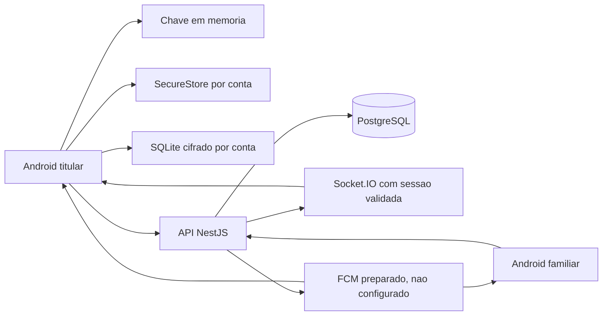
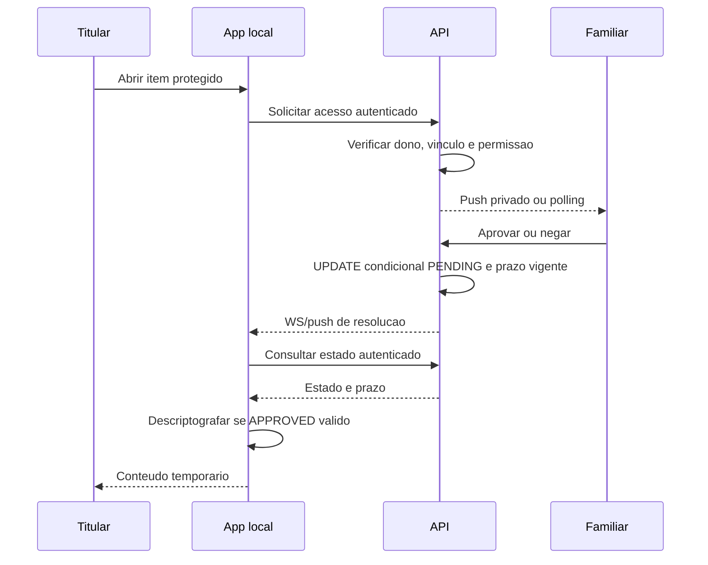
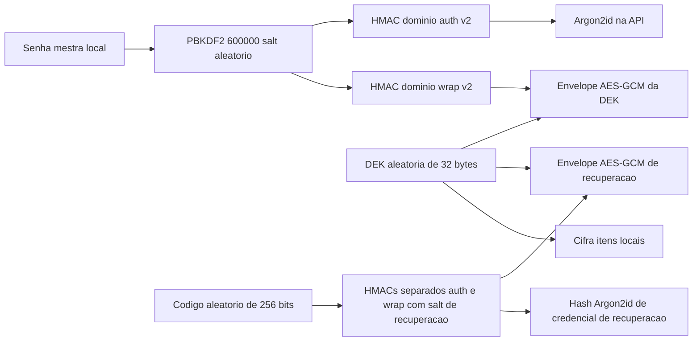

# Arquitetura e Evidencia Tecnica

Fonte para atualizar o documento academico. O DOCX original foi preservado. Diagramas descrevem codigo atual, nao certificacao de seguranca nem teste de usuarios concluido.

## Componentes

AES-256-GCM usa IV de 12 bytes e tag de 16 bytes anexada ao ciphertext em Base64. PBKDF2-HMAC-SHA256 usa 600.000 iteracoes e salt de 16 bytes. Interoperabilidade com WebCrypto foi testada. RNG vem de Expo Crypto, sem Math.random.

O patch pnpm de `@noble/hashes@1.8.0` faz o loop assincrono ceder a timers reais e reinicia seu timestamp depois de cada pausa. A revisao no Hermes mostrou que isso nao resolve o custo de SHA-256 em JavaScript: uma derivacao ficticia continuava apos 325 segundos. Ao atualizar a dependencia, reavaliar o patch e manter o teste de regressao.

O Android configura um provedor PBKDF2 assincrono nativo via `react-native-quick-crypto`/OpenSSL e Nitro Modules. O contrato conserva SHA-256, 600.000 iteracoes, salt de 16 bytes, chave de 32 bytes e UTF-8. Testes conferem referencia Node, limpeza dos buffers e rejeicao de falhas sem fallback inseguro. Expo Go rejeita a operacao explicitamente; exige development build. Node/web mantem o provedor portatil. Os testes nao substituem desempenho e fluxo completo no build Android.

Login/senha/site/notas do cofre sao cifrados no cliente. Nomes/categorias/favoritos/versoes e perfil/auditoria sao legiveis. Contas v2 enviam uma credencial HMAC derivada, nunca a senha mestra, a chave ou o codigo de recuperacao. A compatibilidade v1 envia a senha antiga uma vez durante a migracao automatica. Isso nao comprova zero-knowledge estrito contra um cliente/servidor comprometido nem elimina ataques de dicionario a senhas fracas.

## Acesso Assistido

A janela e de dois minutos a partir do pedido, nao apos aprovar. A resposta concorrente que perde nao emite outra resolucao. Estado recupera eventos perdidos; revogacao invalida aprovacao na consulta. E controle de fluxo no cliente: familiar nao libera material criptografico, e titular ja possui a chave local.

Emergencia offline exige reautenticacao, grava evento antes de descriptografar e envia idempotentemente. Auditoria marca `offline_client_report`; servidor nao prova independentemente a biometria. Criacao nova envia um push privado de emergencia aos familiares autorizados; repeticao nao envia outro. Push e best effort, nao uma fila de entrega garantida. Nenhuma senha do item e enviada ao familiar.

Cancelamento compete com aprovacao por UPDATE condicional de PENDING, restrito ao solicitante. Historico tem paginas de 30, cursor e ordenacao por requestedAt/id; metadados so aparecem ao dono ou familiar ativo autorizado.

## Sincronizacao

- UUID da operacao, versao base e receipt `userId/operationId` na mesma transacao.
- ID offline: `sf_` + SHA-256 de `userId:clientId`; retransmissao nao cria outro registro.
- Versao base deve corresponder ao servidor; nao e last-write-wins pelo relogio do aparelho.
- Exclusao cria tombstone versionado e limpa ciphertext/IV no servidor. Tombstones permanecem enquanto a conta existir.
- Ack so confirma operacao ainda correspondente ao upload; edicao posterior continua pendente.
- Merge preserva sujos, exclusoes locais e conflitos. Aceitar servidor descarta explicitamente; preservar edicao de item excluido cria outro ID.
- Alias de ID e atualizado atomicamente com ack, preservando telas abertas e evitando reimportar copia legada.
- Geracao de sessao, verificacao de proprietario e cancelamento impedem aplicar resposta velha a outra conta.

## Sessao e Privacidade

JWT carrega ID de sessao; API/WS verificam usuario ativo, revogacao e expiracao. Refresh de 32 bytes e rotacionado; banco guarda SHA-256. O aparelho persiste um UUID antes de renovar. A mesma operacao pode repetir por 60s usando hash anterior, UUID e HMAC do servidor, devolvendo o mesmo token sem nova rotacao. UUID diferente, sessao revogada, proxima rotacao ou janela vencida nao reutilizam o token antigo. Fora dessa janela pode ser necessario entrar novamente; o cofre offline nao depende do JWT. Limites por rota/IP devem ser medidos em rede/aparelhos reais.

Chave em memoria apagada no bloqueio/logout. Geracao de sessao impede login/desbloqueio tardio de reabrir o cofre. SecureStore por conta protege copia biometrica quando disponivel e o envelope de senha v2 para desbloqueio offline; v1 mantem verificador legado. Handles JavaScript nao equivalem a chaves nao extraiveis em hardware.

Login e desbloqueio liberam a tela depois de abrir a chave e inicializar SQLite. Perfil, sincronizacao e push sao iniciados em segundo plano; resposta tardia so atualiza o indicador online se a geracao da sessao continuar valida. Acesso offline nao fica aguardando renovacao de JWT ou disponibilidade da API.

Auto-lock: background e dois minutos sem toque. Screen capture e backup automatico Android desativado foram preparados; eficacia precisa de aparelho. Clipboard guarda fingerprint e limpa valor correspondente em 30s/bloqueio/blur, mas nao controla terceiros/historico do SO.

Exclusao exige senha, remove dados ativos por cascade e anonimiza referencias ao cuidador excluido. Outros aparelhos offline/backups exigem procedimento proprio. Historico resolvido: 365 dias com cron diario.

## Protecao V2 e Recuperacao

HMACs usam dominios separados para autenticacao e wrapping. O conteudo autenticado de cada envelope inclui seu contexto/salt. Credencial de login nao abre o envelope; a API guarda somente envelopes e hashes de credenciais. Parametros publicos de login sao limitados por IP/rota; parametros falsos de contas inexistentes usam HMAC privado. Isso nao e um PAKE nem promessa de eliminacao completa de enumeracao.

Nova conta usa DEK aleatoria. Na migracao, a chave PBKDF2 legada e preservada como DEK, para nao perder itens offline ou mudar ciphertext existente. Trocar senha reencapsula essa mesma DEK sob salt novo. Recuperacao verifica o kit na API, abre sua DEK localmente e instala novos envelopes/credenciais com kit novo.

securityVersion e os hashes anteriores controlam o CAS dentro de transacao serializavel. Mudanca de seguranca e revogacao de todas as sessoes sao atomicas. Cliente nao instala um envelope sem antes conseguir abri-lo; uma resposta perdida depois do commit requer login com a nova senha. Nenhuma dessas operacoes apaga chaves/copias em aparelhos offline.

Codigo pendente fica no SecureStore ate confirmacao de guarda externa, associado ao recoverySalt para nao apresentar um kit cuja instalacao falhou. Um envelope local confirmado permite exibi-lo offline. Confirmar remove o codigo do aparelho. Sem senha/kit/chave local disponivel, o conteudo cifrado nao e recuperavel por reset administrativo.

Testes cobrem preservacao do ciphertext legado, credencial separada, senha/codigo incorretos, adulteracao, CAS, revogacao, kit anterior invalidado, cadastro/migracao mobile e contrato HTTP real. Novo aparelho Android, queda de rede nas etapas, biometria e uso por idosos ainda precisam de evidencia fisica.

## Evidencias Academicas Pendentes

Remover promessas de voz, geolocalizacao, rastreamento, chatbot externo, autofill e publicacao iOS. Registrar versoes, comandos, tipos de testes, consentimento e resultados fisicos reais. A inspecao visual web usou apenas metadados ficticios em memoria; nao representa uso nativo, estudo com idosos ou artefato publicado. Capturas academicas devem ser anonimas e nunca incluir senha, kit, token ou participante identificavel.