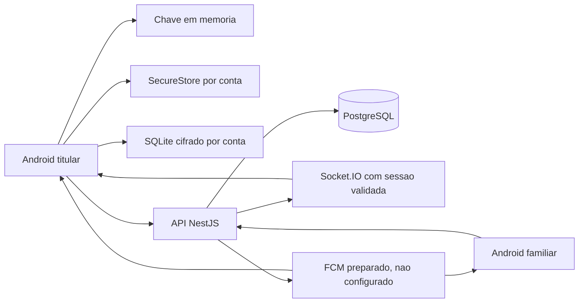
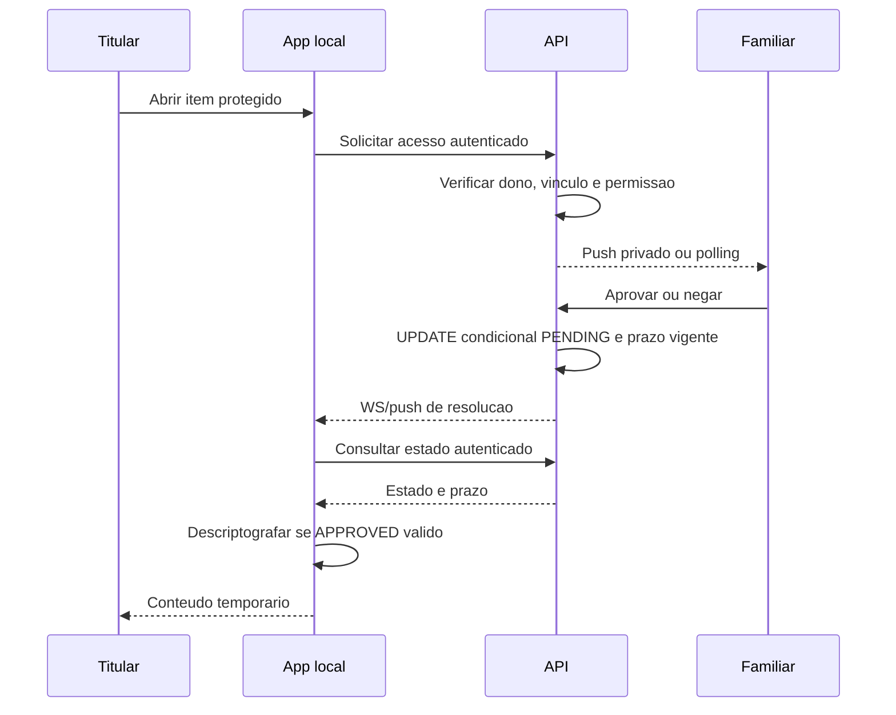

# Arquitetura e Evidencia Tecnica

Fonte para atualizar o documento academico. O DOCX original foi preservado. Diagramas descrevem codigo atual, nao certificacao de seguranca nem teste de usuarios concluido.

## Componentes

AES-256-GCM usa IV de 12 bytes e tag de 16 bytes anexada ao ciphertext em Base64. PBKDF2-HMAC-SHA256 usa 600.000 iteracoes e salt de 16 bytes. Interoperabilidade com WebCrypto foi testada. RNG vem de Expo Crypto, sem Math.random.

Login/senha/site/notas do cofre sao cifrados no cliente. Nomes/categorias/favoritos/versoes e perfil/auditoria sao legiveis. A autenticacao atual envia a senha mestra a API para verificacao Argon2id: nao ha zero-knowledge estrito contra o proprio servidor. Esse limite precisa constar no trabalho e ser corrigido antes de publicar.

## Acesso Assistido

A janela e de dois minutos a partir do pedido, nao apos aprovar. A resposta concorrente que perde nao emite outra resolucao. Estado recupera eventos perdidos; revogacao invalida aprovacao na consulta. E controle de fluxo no cliente: familiar nao libera material criptografico, e titular ja possui a chave local.

Emergencia offline exige reautenticacao, grava evento antes de descriptografar e envia idempotentemente. Auditoria marca `offline_client_report`; servidor nao prova independentemente a biometria. Nenhuma senha do item e enviada ao familiar.

## Sincronizacao

- UUID da operacao, versao base e receipt `userId/operationId` na mesma transacao.
- ID offline: `sf_` + SHA-256 de `userId:clientId`; retransmissao nao cria outro registro.
- Versao base deve corresponder ao servidor; nao e last-write-wins pelo relogio do aparelho.
- Exclusao cria tombstone versionado e limpa ciphertext/IV no servidor. Tombstones permanecem enquanto a conta existir.
- Ack so confirma operacao ainda correspondente ao upload; edicao posterior continua pendente.
- Merge preserva sujos, exclusoes locais e conflitos. Aceitar servidor descarta explicitamente; preservar edicao de item excluido cria outro ID.
- Alias de ID e atualizado atomicamente com ack, preservando telas abertas e evitando reimportar copia legada.
- Geracao de sessao, verificacao de proprietario e cancelamento impedem aplicar resposta velha a outra conta.

## Sessao e Privacidade

JWT carrega ID de sessao; API/WS verificam usuario ativo, revogacao e expiracao. Refresh de 32 bytes e rotacionado; banco guarda SHA-256. Resposta perdida na rotacao ainda exige estrategia de recuperacao. Limites globais/login/register/refresh precisam ser medidos contra polling real.

Chave em memoria apagada no bloqueio/logout. SecureStore por conta protege copia biometrica quando disponivel e verificador cifrado para senha offline. Handles JavaScript nao equivalem a chaves nao extraiveis em hardware.

Auto-lock: background e dois minutos sem toque. Screen capture e backup automatico Android desativado foram preparados; eficacia precisa de aparelho. Clipboard guarda fingerprint e limpa valor correspondente em 30s/bloqueio/blur, mas nao controla terceiros/historico do SO.

Exclusao exige senha, remove dados ativos por cascade e anonimiza referencias ao cuidador excluido. Outros aparelhos offline/backups exigem procedimento proprio. Historico resolvido: 365 dias com cron diario.

## Proxima Mudanca Critica: Recuperacao

Reset de autenticacao nao recupera o cofre. Troca de senha precisa preservar a chave de dados por envelope cifrado sob uma chave derivada da nova senha, nao apenas trocar KDF e tornar itens indecifraveis.

Separar prova de autenticacao da chave de cifragem; usar segredo de recuperacao de alta entropia; guardar material cifrado/credencial verificadora no servidor; planejar migracao de contas antigas. Validar enrolamento, senha/segredo errados, adulteracao, rotacao, falha entre etapas, revogacao, outro aparelho e concorrencia. Essa mudanca ainda nao implementada.

## Evidencias Academicas Pendentes

Remover promessas de voz, geolocalizacao, rastreamento, chatbot externo, autofill e publicacao iOS. Registrar versoes, comandos, tipos de testes, consentimento e resultados fisicos reais. Capturas anonimas somente apos validar telas; nunca senhas/tokens/participantes identificaveis. Nenhum screenshot, estudo com idosos ou artefato publicado foi fabricado nesta entrega.